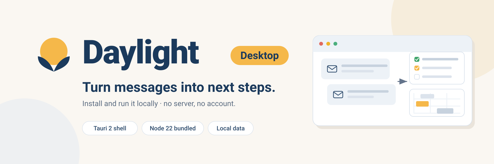
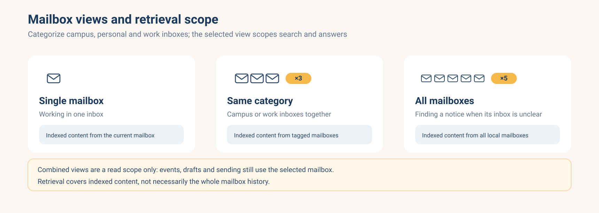
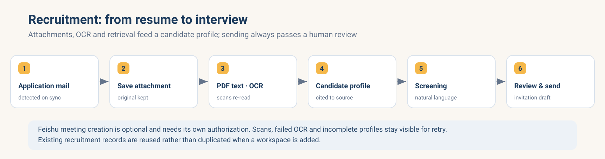
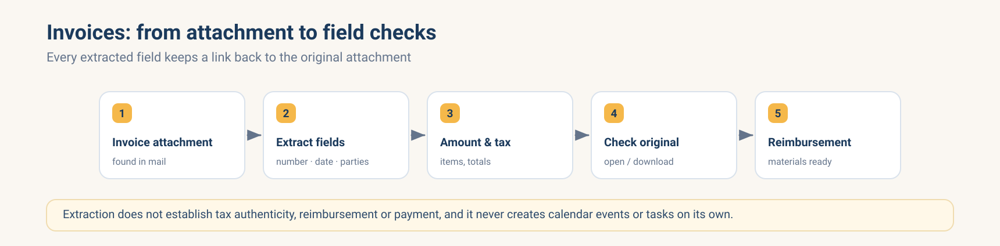
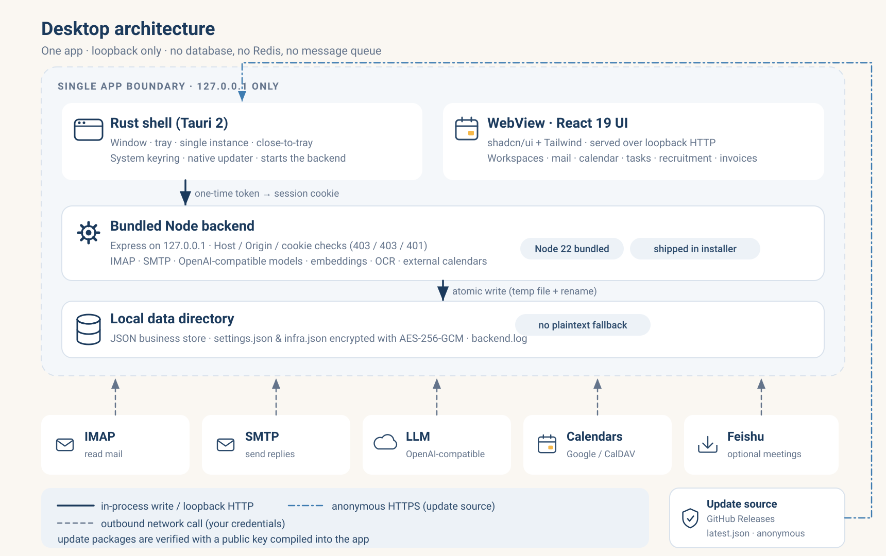
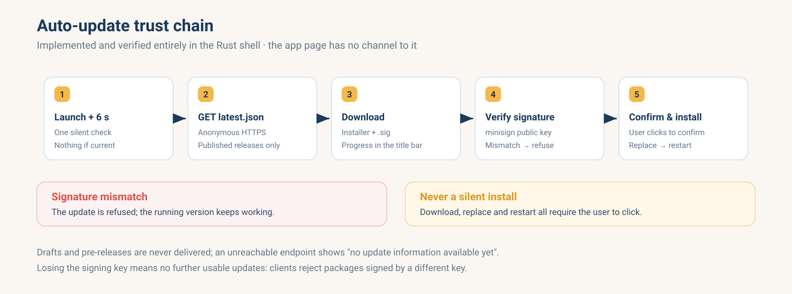

<div align="center">
  
  <p><strong>让分散的信息，成为可追踪的下一步。</strong></p>
  <p>邮件驱动的多场景 Agent 桌面应用 · Tauri 2 + 内置 Node 后台 · UCloud 优刻得 AI 黑客松 · Track B / AI Application</p>
  <p><strong>简体中文 · <a href="README_EN.md">English</a></strong></p>
  <p>
    
    
    =22, bundled" />
    
    
    
  </p>
  <p><a href="#overview">项目介绍</a> · <a href="#quickstart">下载安装</a> · <a href="#desktop">桌面端行为</a> · <a href="#architecture">系统架构</a> · <a href="#update">自动更新</a> · <a href="#development">开发与打包</a> · <a href="#evidence">验证与边界</a> · <a href="#contributing">参与项目</a></p>
</div>

<details>
<summary><strong>目录</strong></summary>

[项目介绍](#overview) · [快速开始](#quickstart) · [桌面端专有行为](#desktop) · [功能一览](#capabilities) · [多邮箱](#mailboxes) · [招聘与发票](#workflows) · [架构](#architecture) · [开始使用](#usage) · [自动更新与发布](#update) · [本地开发与打包](#development) · [与真源对齐](#sync) · [验证与边界](#evidence) · [项目结构](#structure) · [路线图](#roadmap) · [参与项目](#contributing)

</details>

---

<a id="overview"></a>
## ☀️ 项目介绍

**Daylight Desktop 是一个下载即用的邮件管理 Agent 桌面应用。** 它通过 IMAP 读取你自己的邮箱，调用 OpenAI 兼容大模型提取日程、待办、发票与招聘信息，把邮箱、附件、日历和待办放在一起，帮你找回通知、整理材料、跟进进度、准备回复。**打开过邮件，并不代表事情已经办完。**

- **无需自建服务**：安装包内置 Node.js 后台，终端用户不装 Node、不装数据库、不开 Docker，也不配置服务器。
- **无需账号体系**：没有注册、登录、找回密码和管理后台。应用在本机生成一次性会话，打开就是工作区。
- **数据默认留在本机**：业务数据保存在本机数据目录，凭据加密落盘；只有你配置的模型服务商会收到分析所需的邮件上下文。
- **与 Web 版同源**：`src/`、`server/`、`shared/` 等业务代码与 [Daylight（Web / 云原生版）](https://github.com/why121368/Daylight) 共享，桌面端只替换壳层、本地会话、加密落盘与打包流程。

| 常见做法 | Daylight Desktop 的处理方式 |
| --- | --- |
| 标星后还要记得回来看 | 把通知关联到事项，分开记录待办、阶段和材料 |
| 在邮箱里反复搜关键词 | 用自然语言查找已入库邮件和附件，点击回答返回原文 |
| 校园、个人、工作邮箱来回切换 | 按邮箱分类，可只看一个、同类混合或全部混合 |
| 改期后手工重写日历 | 保留原安排和变更来源，关联新旧日程 |
| 为了用上 AI，先搭服务器、数据库和账号体系 | 下载安装包即可运行，内置 Node 后台，数据默认留在本机 |
| 简历与发票附件分散 | 在招聘、发票页面集中查看，处理结果可对照原件 |

**当前交付：** 桌面壳层、本地单用户工作区、预置场景模板、知识检索、小 D 助手，以及原生侧自动更新的完整框架。六种目标（macOS arm64/x64、Windows x64/arm64、Linux x64/arm64）的安装包已在 CI 真实构建，**最新正式版本 [`v0.1.1`](https://github.com/yunforis/DaylightDesktop/releases/tag/v0.1.1) 已发布**（`v0.1.0` 的 macOS 包在 Apple Silicon 上会显示「已损坏」，`v0.1.1` 修掉了它）：一轮完整发布跑通了「校验版本 → 六平台构建 → 修整 `latest.json`」全部环节，Release 里收齐 **27 个产物**（`.dmg` / `.app.tar.gz` / NSIS `-setup.exe` / `.msi` / `AppImage` / `.deb` / `.rpm` 与各自的 `.sig`，以及 `latest.json`）；标签指向构建这批产物的提交 `5aff4b3`，`latest.json` 的 18 个平台键全部指向公开下载地址，公开更新地址已实测匿名可达（HTTP 200，且取样下载到的是二进制而不是元数据 JSON）。**安装包尚未在真实 Windows / Linux 机器上启动过**；未验证项逐条记录在 [STATUS](STATUS.md) 与[已知边界](#evidence)。

<a id="quickstart"></a>
## ⚡ 快速开始

安装包由本仓库的 [Releases](https://github.com/yunforis/DaylightDesktop/releases) 提供。下载对应平台的文件，安装后打开应用即进入工作区——**不需要注册、登录、数据库或命令行**，安装包内已包含 Node 二进制、后台代码、前端产物与运行时依赖。

**首次使用只有两步：**[连接邮箱与模型](#usage) → 同步并查看提取结果。与 Web 版不同，桌面端没有管理员初始化、没有系统 SMTP、没有自助注册，也不需要配置任何环境变量。

| 平台 | 安装包 | 说明 |
| --- | --- | --- |
| macOS Apple Silicon | `.dmg`（`_aarch64`） | 已做 ad-hoc 签名，首次打开需在「系统设置 → 隐私与安全性」放行一次；**未做 Developer ID 签名与公证** |
| macOS Intel | `.dmg`（`_x64`） | 在 Apple Silicon 上交叉构建（GitHub 已不提供 x64 的 macOS runner） |
| Windows x64 / arm64 | NSIS `.exe`（`_x64-setup.exe` / `_arm64-setup.exe`）、`.msi` | 自动更新用 NSIS；`.msi` 供手动安装 |
| Linux x64 / arm64 | `AppImage`、`.deb`、`.rpm` | 仅 AppImage 支持自动更新 |

每个平台的打包产物同时包含自动更新用的签名文件（`.sig`）；`latest.json` 由发布流水线统一生成并校验六个平台是否齐全。产物名称、大小与平台覆盖以 [Releases](https://github.com/yunforis/DaylightDesktop/releases) 实际内容为准。

> **`v0.1.0` 的 macOS 包在 Apple Silicon 上会显示「已损坏，无法打开」，`v0.1.1` 已修掉**：那一版的 macOS 产物只带链接器自动加的签名、**没有整包签名**（缺 `Contents/_CodeSignature/CodeResources`），macOS 因此拒绝加载它——这不是下载损坏，文件大小与 Release 完全一致。`v0.1.1` 起构建会做 ad-hoc 整包签名，CI 也会校验产物。若你还在用 `v0.1.0`，装到 `/Applications` 后手动补一次签名：
>
> ```bash
> sudo xattr -dr com.apple.quarantine /Applications/Daylight.app
> sudo codesign --force --deep --sign - /Applications/Daylight.app
> ```
>
> 之后正常打开；`v0.1.1` 及以后只需在「系统设置 → 隐私与安全性」里点一次「仍要打开」。

- 只想用：下载安装 → [开始使用](#usage)
- 想知道桌面端和 Web 版差在哪：[桌面端专有行为](#desktop)
- 想改代码或自己打包：[本地开发与打包](#development)
- 想看实现范围与未验证项：[验证与边界](#evidence)

<a id="desktop"></a>
## 🖥️ 桌面端专有行为

桌面端不是「把 Web 塞进浏览器窗口」，本地形态带来一组明确不同的行为：

- **无登录页**：原生壳层生成一次性 token，用它打开 `/desktop/start?token=…` 换取 HttpOnly cookie，前端再用 cookie 调 `/desktop/session` 拿到本地 `owner@daylight.local` 会话。没有 Landing、注册、找回密码、法律页和管理端页面。
- **访问控制**：后台只监听 `127.0.0.1`，并要求 `Host` 为回环地址、`Origin` 与自身一致、且带壳层 cookie。缺一层分别得到 403 / 403 / 401。
- **管理端接口不可达**：`/api/admin/*` 在桌面模式统一返回 404（实现保留，仅屏蔽路由）。
- **凭据加密落盘**：`settings.json` 与 `infra.json` 用 AES-256-GCM 加密保存（密钥来自系统凭据库，经环境变量注入后台进程）。拿不到密钥时**明确报错**，不会静默降级成明文。其余业务 JSON 保持明文并使用临时文件 + rename 原子写入。
- **数据目录**：由壳层传入（macOS `~/Library/Application Support/com.daylight.desktop`，Windows `%APPDATA%\com.daylight.desktop`，Linux `~/.local/share/com.daylight.desktop`）。后台诊断日志为该目录下的 `backend.log`。
- **端口回退**：首选端口被占用时自动改用随机端口，再通过 `DAYLIGHT_READY <port>` 通知壳层导航。窗口打不开的情况不会以「静默失败」收场。
- **生命周期**：关闭窗口隐藏到托盘（托盘菜单：打开 / 数据目录 / 退出）；单实例；窗口大小位置记忆；退出时先向后台 stdin 写 `shutdown` 再等待，最多 3 秒后强杀，避免数据写一半。
- **PDF 预览**：直接复用与 Web 相同的 `src/components/pdf-preview.jsx`（`pdfjs-dist` 在页面内渲染），不依赖各平台 WebView 的内置 PDF 能力；CMap、标准字体与 wasm 解码器经 `import.meta.glob` 打进前端产物，离线可用。Office 文档在桌面端走「该附件暂无公网地址，无法内嵌 Office 预览」分支：附件地址都是相对路径，不会去请求 `view.officeapps.live.com`。
- **外部链接**：`http(s)` / `mailto` 交给系统浏览器；本机 PDF 用应用内查看器。
- **语音输入**：小 D 复用浏览器 `SpeechRecognition`，先做能力探测；不支持时提示改用键盘输入。

<a id="capabilities"></a>
## 🧩 功能一览

业务功能与 Web 版一致，细节见 [STATUS.md](STATUS.md)。

### 六类预置工作台

| 场景 | 管理对象与关键流程 | 业务边界 |
| --- | --- | --- |
| **智能招聘** | 候选人、简历 PDF/OCR、筛选、知识检索、面试邀约及沟通 | 实际发信审核确认；飞书需另行配置与授权 |
| **发票助手** | 附件票据、字段核对、原件回查与报销准备 | 提取结果对照原件核验，不据此自动改日程/待办 |
| **保研申请** | 夏令营、预推免、导师联系；多校机会、材料、限时确认、面试及改期 | 优秀营员、欢迎报考不等于正式录取；外部报名需回执 |
| **申博 / 海外研究 / RA** | 联系人上下文、研究计划版本、跨时区面谈、后续跟进 | 礼貌回复不代表名额承诺；保留原时区、UTC 与北京时间 |
| **校招求职** | 公司与岗位、测评笔试、材料补交、面试和投递进度 | 补材料不自动晋级；平台/短信/微信信息需补充 |
| **科研投稿与参会** | 修订、共同作者前置行动、终稿、注册缴费与报告安排 | 投稿与缴费状态需要外部证据 |

### 平台能力

| 模块 | 主要功能 | 使用说明 |
| --- | --- | --- |
| **智能招聘** | 候选人、简历 PDF/OCR、筛选与面试邀约 | 引用简历原文；审核后发送；飞书可选 |
| **发票助手** | 号码、购销方、金额、税额与明细提取 | 对照原件核对，保留附件查看入口 |
| **多邮箱** | 常用邮箱与自定义 IMAP/SMTP、分类与混合查看 | 账号/邮箱隔离，支持来源关联及外部通知 |
| **日历待办** | 月/周/日视图、截止、优先级、冲突与改期 | 保留来源；按工作台筛选并核验完成状态 |
| **事项材料** | 业务阶段、建议、材料版本与前置行动 | 保留历史，关键阶段需要回执 |
| **小 D 助手** | 查邮件、做简报、管理日程待办、起草回复 | 支持语音输入、会议辅助与发送审核 |
| **知识检索** | 邮件/附件/简历分块、混合检索与原文高亮 | RRF 融合、MMR 去冗余、Embedding 限流重试 |
| **模板定制** | 字段、阶段、规则、材料、页面块与能力配置 | JSON 导入导出、升级、显隐与删除 |
| **日志费用** | 工具调用、错误、耗时、Token 与费用 | 按调用时价格统计，显示已知费用及覆盖率 |
| **外部协作** | 外部日历（Google / Outlook / CalDAV）、私密 ICS、活动材料 | 推送失败不阻断本地写入，错误记在连接记录 |
| **本地会话** | 壳层一次性 token 与本机单用户工作区 | 无多租户、无管理后台、仅回环监听 |
| **后台任务页** | 状态展示 | 本地模式下显示「当前服务未启用后台任务」，同步结果在邮件与执行记录中查看 |

<a id="mailboxes"></a>
## 📬 多邮箱，分开看，也能一起找

为校园、生活和工作邮箱设置分类。日历与待办按当前范围展示；邮件页问答和小 D 的知识检索也使用所选范围，从已入库内容中找回通知。



| 视图 | 适合什么情况 | 检索范围 |
| --- | --- | --- |
| **单邮箱** | 只处理当前收件箱 | 当前自有邮箱的已入库内容 |
| **同类混合** | 一起看校园或工作分类 | 同标签下自有邮箱的已入库内容 |
| **全部混合** | 找不清在哪个邮箱的通知、统筹安排 | 本机全部自有邮箱的已入库内容 |

桌面端是**单用户本机应用**，因此不存在跨用户权限问题；但混合视图同样只是读取范围，不会把写操作广播到全部邮箱。普通建日程、草稿和发送仍使用当前选中的邮箱；工作台使用其绑定邮箱。检索只能找回已建立索引的内容，不能保证历史邮箱全部覆盖。

<a id="workflows"></a>
## 🧑‍💼 招聘与发票：两条主要使用流程

### 招聘：从简历到面试沟通

收到求职邮件 → 保存附件 → 提取 PDF 文字或 OCR → 整理候选人资料 → 对话筛选 → 准备邀约 → 人工审核发送。

在人才库查看资料、简历与来源，提问时可以返回对应页码和原文。扫描件、识别失败与信息不全需回查或重试；飞书建会是可选能力，需自行配置。既有招聘数据直接复用，不因添加工作台复制一份。

<details>
<summary>查看招聘处理流程图</summary>



</details>

### 发票：从邮件附件到字段核对

发现票据附件 → 提取号码、日期、购销方、金额/税额和明细 → 对照原票 → 整理报销材料。

发票页保留原附件查看/下载入口；提取结果需要核对，不代表税务验真、已经报销或完成付款。识别发票本身不会自动生成日程与待办。

<details>
<summary>查看发票处理流程图</summary>



</details>

<a id="architecture"></a>
## 🏗️ 系统架构



```text
Daylight Desktop（Tauri 2 应用）
├─ React 前端（shadcn/ui + Tailwind）                    ← 与 Web 共享
├─ Rust 壳层（src-tauri/）
│  ├─ 窗口 / 托盘 / 单实例 / 关闭到托盘 / 窗口状态记忆
│  ├─ 系统凭据库（keyring）保存数据加密密钥，无明文降级
│  ├─ 原生自动更新（下载 / minisign 校验 / 替换 / 重启）
│  └─ 启动内置 Node 后台、解析就绪端口、外部链接走系统浏览器
└─ 内置 Node 后台（src-tauri/runtime/，随安装包分发）      ← 与 Web 共享
   ├─ IMAP / SMTP / 大模型 / OCR
   ├─ 日程 / 待办 / 邮件 / 发票 / 招聘 / 小 D / 日志
   └─ 本地数据存储（默认 JSON，无需数据库）
```

| 组件 | 职责 | 主要技术与状态 |
| --- | --- | --- |
| **桌面窗口** | 托盘、单实例、窗口状态、外部链接、自动更新入口 | Tauri 2（Rust）、系统 WebView |
| **Web 前端** | 工作台、邮箱、日历、待办、招聘、发票、审核与执行记录 | React 19、Vite 7、Tailwind CSS 4、shadcn/Radix、FullCalendar |
| **本地后台** | 鉴权、邮箱归属、业务提交、模型与工具调用 | Node.js 22+、Express（内置运行时，仅监听回环） |
| **本地存储** | 设置、日程、待办、邮件、招聘、发票等业务快照 | JSON + 临时文件 rename 原子写；`settings.json` / `infra.json` 走 AES-256-GCM |
| **系统凭据库** | 保存数据加密密钥 | macOS Keychain / Windows Credential Manager / Linux Secret Service |
| **外部服务** | 收信、回信、模型、日历和会议 | IMAP/SMTP、OpenAI 兼容 Chat Completions、Embedding、可选飞书等 |
| **更新源** | 分发已发布版本的元数据 | GitHub Releases 的 `latest.json`（匿名地址，需仓库保持公开） |

### 本地模式与一致性

**默认本地模式不连 PostgreSQL / Redis / RabbitMQ，只监听 `127.0.0.1`**，同步在进程内完成。这意味着桌面端没有跨进程的任务租约与 outbox；长同步在请求内完成，页面通过状态轮询与 trace 观察进度。JSON 写入以临时文件 + rename 保证原子性，但**同一数据目录不能给多个后台进程同时写入**。

邮件内容作为数据处理。已读、已准备、已发送、已提交、对方确认分别管理。工作台建议确认后写入，基础邮件同步可按提取结果直接创建日程/待办；实际发信经过独立审核。模型无效输出、工具错误和歧义需在界面与记录中体现。

<a id="usage"></a>
## 🧭 开始使用

1. **连接邮箱**：在应用内「设置」添加收信邮箱，填写 IMAP/TLS 与**授权码 / 应用专用密码**（不是登录密码）。QQ 邮箱为 `imap.qq.com:993`、`smtp.qq.com:465`，需先在邮箱设置里开启 IMAP/SMTP 服务。首次联调建议读取数量设为 3–5 封。
2. **配置模型**：填写 OpenAI 兼容 Chat Completions 的 Base URL、API Key 与模型名，要求支持 `response_format: { type: 'json_object' }`。可选填人民币单价用于费用估算。向量检索还需可用 Embedding；没有向量时可走关键词检索。
3. **同步与检索**：打开邮件页同步，查看分类摘要、提取结果及失败原因；从问答引用返回原邮件与命中段落。最近 N 封范围之外的信息不会自动获得全量扫描保证。
4. **添加工作台**：选择预置模板、绑定邮箱、建立事项；关联通知或粘贴外部来源，查看材料、阶段建议及行动。
5. **确认行动**：核对期限、时区、目标与冲突，采用阶段建议，确认写入待办/日历；提交、发送、对方确认分别登记。前置行动仅添加待办还不能解锁后续，需完成相应回执。
6. **使用小 D**：查询、规划或起草回复，检查收件人/正文/引用后确认发送。保存草稿或登记「已发送」不会代发邮件；实际发送使用审核卡。
7. **跟进变更**：后续补充、取消和改期保留来源及历史；新旧日程可追溯，执行证据中核对耗时与费用。

> 保存成功或页面显示「已配置」**只表示字段已保存**，不代表邮箱或模型连接成功。真实连通性需要用真实邮箱和真实模型跑一次同步才能确认。

模板是声明式 JSON，不执行任意代码。删除工作台保留已写入邮箱的日程/待办/招聘资料；隐藏入口也不删除数据。外部日历失败或结果未知应按恢复契约处理；对方日历、报名平台、付款或投稿系统未接入的操作不能自动判定成功。

### 演示（不连真实邮箱与模型）

应用内置三组**预置提取结果**的演示，可在没有任何配置时体验完整链路，页面与日志都会明确标注为预置结果：演示日程冲突与回复确认、演示新增/取消/调整、演示邮件标签与待办。预置演示不会连接真实邮箱、不会调用真实模型、不会真实发信。示例数据的清除在「设置」中完成，清除示例不会影响真实邮件与手动日程。

<a id="update"></a>
## 🔄 自动更新与发布



### 客户端行为

- 启动约 6 秒后**静默检查**一次更新：已是最新就什么都不做，有更新才弹原生对话框。
- 托盘菜单 →「检查更新…」可手动检查，无论结果如何都会给出反馈。
- **绝不静默安装**：弹窗里点「下载并安装」之后才会下载，下载期间窗口标题显示进度提示，装完自动重启到新版本。本地数据与配置不受影响（更新只替换程序本体）。
- 更新逻辑**全部在 Rust 壳层**（`src-tauri/src/update.rs`）。应用页由回环 HTTP 提供，不给页面调用「替换自己安装文件」这条命令的通道，页面即使被注入也够不到更新能力。
- 更新端点不可达时（还没有正式版本、或网络不通），插件会把它折叠成 `ReleaseNotFound`。原生侧会把这类情况翻译成「还没有取到可用的更新信息」，而不是误报成「网络故障」；缺少当前平台安装包（`TargetNotFound`）也单独区分提示。
- 当前最新是 `v0.1.1`：装了 `0.1.0` 的客户端会看到一次更新提示（`v0.1.0` 的 macOS 包在 Apple Silicon 上装不上，`v0.1.1` 修掉了签名问题）；**下载 → 校验 → 替换安装文件 → 重启**这条链路仍未做端到端验证。

### 信任链

更新包用 minisign 签名，客户端用编译进去的公钥校验，校验不过就拒绝安装。

| 东西 | 位置 | 是否可公开 |
| --- | --- | --- |
| 公钥 | `src-tauri/tauri.conf.json` 的 `plugins.updater.pubkey` | 可提交 |
| 私钥 | 本机 `work/updater-key/daylight.key`（`work/` 不进仓库）+ GitHub Secret `TAURI_SIGNING_PRIVATE_KEY` | **绝不可提交** |

更新源固定为 `https://github.com/yunforis/DaylightDesktop/releases/latest/download/latest.json`（与 `package.json` 的 `repository` 一致，`desktop-tests` 会交叉校验）。它只指向**已发布的正式版本**，草稿与预发布不会推送给客户端。

丢失私钥就无法再发布可用的更新（客户端会拒绝用别的密钥签出来的包），请妥善备份 `work/updater-key/`。

### 发布六平台安装包

打标签即发布（`.github/workflows/release.yml`）：

```bash
# 1. 三处版本必须一致，否则 guard 任务会直接挡住
#    package.json / src-tauri/tauri.conf.json / src-tauri/Cargo.toml
# 2. 提交后打标签并推送
git tag v0.1.0
git push origin v0.1.0
```

也可以到 Actions 页面手动运行 `release` 工作流，填一个标签（标签不存在时会在本次运行的提交上创建），并可勾选 **「只产出草稿 Release」**只构建不公开——用于先验证六平台能不能都出包。**草稿验证通过后，直接在 Releases 页面把这份草稿发布出去**即为正式发布：草稿里已经有全部产物与 `latest.json`。

> ⚠️ 重复运行同一条标签时 `guard` 的行为：如果那份 Release **还是草稿**，会被复用，同时把 `target_commitish` 更新到本次运行的提交——这样发布出来的标签指向的才是真正构建这批产物的提交（`v0.1.0` 踩过一次：草稿由更早的运行创建，标签差点指向与产物相差两个提交的位置）。如果标签下的 Release **已经正式发布**，这一轮会**整体跳过**（空操作）：已发布的产物不允许被静默替换。另外，草稿的 `tag_name` 可能被 GitHub 归一化成 `untagged-<hash>`（草稿的 Git 标签还没创建时）——直接发布就会创建一个名叫 `untagged-…` 的标签，**所以发布前要用 API 核对一遍标签名**（`v0.1.1` 发布前实测遇到；`guard` 现已改为复用草稿时写回 `tag_name`、并按 `name` 兜底查找草稿以免再建一份重复草稿）。

> ℹ️ 在 Releases 页面发布草稿后，Actions 里会**再出现一次** `release` 运行——这是正常的：发布草稿会创建 Git 标签，而本工作流由 `push: tags: v*` 触发。这次运行会走「已正式发布 → 跳过」，几秒内绿灯结束，不重建、不改 `latest.json`。

| 平台 | Runner | Rust target |
| --- | --- | --- |
| macOS Apple Silicon | `macos-14` | `aarch64-apple-darwin` |
| macOS Intel | `macos-14`（交叉构建） | `x86_64-apple-darwin` |
| Linux x64 | `ubuntu-22.04` | `x86_64-unknown-linux-gnu` |
| Linux ARM64 | `ubuntu-24.04-arm` | `aarch64-unknown-linux-gnu` |
| Windows x64 | `windows-latest` | `x86_64-pc-windows-msvc` |
| Windows ARM64 | `windows-11-arm` | `aarch64-pc-windows-msvc` |

`fail-fast: false`：某个平台失败不影响其余平台；Release 里就少那一个产物，已发布的版本对能装的平台照常可用。

**Release 只创建一次**：`guard` 任务校验三处版本一致后，幂等地创建（或复用）唯一一个 Release 并输出 `releaseId`，六个构建任务都按 `releaseId` 上传产物。这样避免「同一个标签被并发创建出两个草稿 Release」（`tauri-action` 按标签查找时看不到草稿）。全部平台成功后，`finalize` 任务把 `latest.json` 里的下载地址改写成公开链接（`releases/download/<tag>/<file>`）——asset API 地址需要鉴权，客户端直接请求会拿到 JSON 元数据而不是安装包——并重新读取确认六平台齐全。

### 需要在 GitHub 配置的 Secrets

| Secret | 是否必需 | 说明 |
| --- | --- | --- |
| `TAURI_SIGNING_PRIVATE_KEY` | **必需** | `work/updater-key/daylight.key` 的**文件内容**。缺失时打包会在「生成更新产物」这步直接失败——这是刻意的，没有签名不该发布更新 |
| `TAURI_SIGNING_PRIVATE_KEY_PASSWORD` | 可选 | 私钥口令。当前密钥未设口令，**不要填**：让它保持不存在（表达式为空串）与「无口令密钥」是匹配的，本机已实测这一组合能正常签名 |
| `APPLE_CERTIFICATE` / `APPLE_CERTIFICATE_PASSWORD` / `APPLE_SIGNING_IDENTITY` / `APPLE_ID` / `APPLE_PASSWORD` / `APPLE_TEAM_ID` | 可选 | macOS 正式签名与公证（需要付费的 Apple 开发者账号）。**不配也能出包**：签名身份会自动退化为 ad-hoc（`APPLE_SIGNING_IDENTITY=-`），包能安装，用户首次打开需在「系统设置 → 隐私与安全性」里放行一次 |

工作流只在 `APPLE_CERTIFICATE` 非空时才注入证书变量（空变量会让 Tauri 打包器报错）；**没有证书时不是「跳过签名」，而是退化为 ad-hoc 签名**——Tauri 在完全没有签名身份时**不会**给 `.app` 生成 `Contents/_CodeSignature/CodeResources`，这样的包在 Apple Silicon 上会被 macOS 判成「已损坏，无法打开」，用户根本装不上（`v0.1.0` 实测如此）。CI 另有一道对刚打出来的 `.app` 的真校验（要求存在 `_CodeSignature/CodeResources` 且 `codesign --verify --deep --strict` 通过）。本机 `npm run desktop:build` 同样默认 ad-hoc 签名。

### 仓库必须保持公开

更新源 `.../releases/latest/download/latest.json` 是**匿名**地址。仓库转私有后客户端会拿到 404，自动更新整体失效。这一点不能靠客户端绕过去：把仓库的读取 token 打进安装包，等于让每个下载者都能读到整个仓库，而且 token 一过期所有客户端的更新就集体失效。万一仓库确实是私有的，客户端不会崩——托盘菜单会明确显示「还没有取到可用的更新信息」，用户可到 Releases 页面（登录后可见）手动下载覆盖安装。

### Linux / Windows 自更新的产物要求

- **Windows**：自动更新只能安装 **NSIS**（`-setup.exe`）。`targets: "all"` 会同时产出 WiX（`.msi`），而客户端装不了 msi，所以 `release.yml` 里显式设了 `updaterJsonPreferNsis: true`，让 `latest.json` 指向 setup.exe。`.msi` 仍会随 Release 提供，供手动安装。
- **Linux**：只对 **AppImage** 生效（Tauri 替换 AppImage 文件本身）。用 `.deb` / `.rpm` 安装的版本**不会**自动更新——包管理器管着的文件不该由应用自己替换，这类用户需要下载新包重新安装。Release 里三种产物都会出；内置运行时只带 glibc 版本的原生模块。

<a id="development"></a>
## 💻 本地开发与打包

需要 **Node.js 22+**（仓库含 `.nvmrc`）。本机若已把 Rust 工具链放在 `work/toolchain/`（`work/` 不进仓库），`npm run desktop:*` 会自动使用它；**在新机器上需要自行安装 Rust**。

```bash
nvm use            # 切到 .nvmrc 指定的 Node
npm install
npm run desktop:dev   # 开发：Tauri 窗口 + 前端热更新 + Node 后台
```

窗口打开后直接进入 `/app` 工作区，**无需注册或登录**。

### 命令索引

| 命令 | 作用 |
| --- | --- |
| `npm run desktop:dev` | 开发模式桌面窗口（后端固定端口 14321） |
| `npm run dev` | 只在浏览器调试前端：`http://127.0.0.1:3000`（会自动转到 `/app`） |
| `npm run build` | 构建前端产物到 `dist/` |
| `npm run desktop:prepare` | 生成内置 Node 运行时到 `src-tauri/runtime/` |
| `npm run desktop:check` | Rust 壳层 `cargo check` |
| `npm run desktop:build` | 打包安装包（会先执行 build + prepare） |
| `npm test` | 与 Web 共享的业务测试（`server/*.test.js`） |
| `npm run test:desktop` | 桌面专有测试（`desktop-tests/`） |
| `node scripts/desktop-sync.mjs` | 从 Daylight 真源重新同步业务代码并重贴桌面补丁 |
| `bash work/smoke.sh` | 后端冒烟（生产模式 / 无 PG / 仅回环 / 鉴权边界） |

### 打包前置

`npm run desktop:build` 是一条命令，但不是零前置：

- **Node.js 22+**（构建期用，安装包里另有一份内置 Node，终端用户不需要）。
- **Rust 工具链**（`rustup` + 本机目标）。本机若把工具链放在 `work/toolchain/`，`scripts/desktop.mjs` 会自动使用；否则回落到系统 `cargo`。
- **Linux** 还需要系统库：`libwebkit2gtk-4.1-dev build-essential curl wget file libxdo-dev libssl-dev libayatana-appindicator3-dev librsvg2-dev patchelf`。
- **Windows** 需要 MSVC 生成工具与 WebView2 运行时（安装包用 `downloadBootstrapper` 自动装 WebView2）。

**交叉打包**：安装包内置 Node，所以内置 Node 的架构必须等于安装包架构。用 `DAYLIGHT_TARGET_TRIPLE` 指定目标（脚本会去 nodejs.org 取对应架构的官方 Node，并用 `npm install --os/--cpu` 装对原生模块）：

```bash
DAYLIGHT_TARGET_TRIPLE=x86_64-apple-darwin npm run desktop:prepare
```

Intel Mac 的包正是这样在 Apple Silicon 上交叉构建的（`x86_64-apple-darwin`）——GitHub 已不再提供 x64 的 macOS runner。

**内置运行时只带目标平台的原生模块**：`scripts/prepare-desktop.mjs` 会按锁文件的平台元数据清掉其它平台的原生包，并用独立的 `package.json` 检查再确认一次。这是被真实 CI 缺陷逼出来的：`@napi-rs/canvas` 的平台包没有声明 `libc` 字段，npm 会把 gnu 与 musl 两份都装进来，而 linuxdeploy 会对 AppDir 里每个 ELF 跑 `ldd`，遇到 musl 那份直接失败，导致 AppImage 打包中断（deb/rpm 不受影响）。现在 Linux 只保留 glibc 版本。

### 打包产物

```bash
# 更新产物必须签名；变量要的是密钥文件的「内容」
# 写成路径会让打包器把它当密钥解 base64 而失败
TAURI_SIGNING_PRIVATE_KEY="$(cat work/updater-key/daylight.key)" npm run desktop:build
```

产物在 `src-tauri/target/release/bundle/`：

- macOS：`macos/Daylight.app`（可直接运行）、`dmg/Daylight_<版本>_<arch>.dmg`，以及自动更新用的 `macos/Daylight.app.tar.gz` + `.sig`
- Windows / Linux：在对应平台执行同一命令，产物在各自的 bundle 目录（含更新用的 `.sig`）

安装包内已包含 Node 二进制、后台代码、前端产物与运行时依赖，终端用户无需安装任何环境。macOS 按 arm64 / x64 分别构建，不做通用二进制。打包自动更新产物需要签名私钥（`TAURI_SIGNING_PRIVATE_KEY`），缺失时会在「生成更新产物」这一步直接失败——这是刻意的，没有签名就不该发布更新。

若提示端口被占用，开发模式可换端口：

```bash
PORT=3001 npm run desktop:dev        # macOS / Linux
$env:PORT='3001'; npm run desktop:dev  # PowerShell
```

<a id="sync"></a>
## 🧬 与 Daylight 真源对齐

桌面端与 Web 版共享 `src/`、`server/`、`shared/`、`public/`、`scripts/`。当 Web 侧前进时：

```bash
# 推荐：先导出真源「已提交的 HEAD」作为干净基线（避开真源工作区里未提交的在改代码）
git -C ../Daylight archive HEAD | tar -x -C work/web-head
DAYLIGHT_WEB_DIR="$PWD/work/web-head" node scripts/desktop-sync.mjs --check   # 先校验补丁锚点
DAYLIGHT_WEB_DIR="$PWD/work/web-head" node scripts/desktop-sync.mjs

node scripts/desktop-sync.mjs            # 默认读 ../Daylight（会读到其工作目录，含未提交改动）
DAYLIGHT_WEB_DIR=/path/to/Daylight node scripts/desktop-sync.mjs
```

脚本会：整树复制真源的共享代码 → 移除 Web 专有页面 → 逐条重贴桌面补丁（精确字符串替换，锚点找不到立刻报错）→ 校验运行时依赖白名单覆盖了 `server/` 的全部裸包导入。

**为什么推荐导出 HEAD 而不是直接读工作目录**：真源长期处于并发开发状态，工作目录里常有写了一半的文件。直接整树复制会把这些未提交改动带进桌面端，让「桌面端等于真源哪个提交」这个问题失去答案。用 `git archive HEAD` 得到的是可复现的提交快照。

`Dockerfile` 与 `docs/submission/evaluation-cases.json` 也在同步清单里，**只因为共享测试套件会读取它们**；桌面端不使用容器部署，也不参与比赛材料提交。

**桌面端自有文件不受同步影响**：`src/App.jsx`、`src/lib/desktop.js`、`server/desktop-entry.js`、`server/desktop-http.js`、`server/secure-json.js`、`src-tauri/**`、`scripts/desktop*.mjs`、`scripts/prepare-desktop.mjs`、`desktop-tests/**`。补丁清单与理由见 `STATUS.md`，`desktop-tests` 中有锚点自检测试守护。

<a id="evidence"></a>
## 📊 验证、边界与交付

以下命令构成本仓库的验证入口：

```bash
npm test              # 共享业务测试（server/*.test.js）
npm run test:desktop  # 桌面专有测试（desktop-tests/）
npm run build         # 前端构建
npm run desktop:check # Rust 壳层检查
bash work/smoke.sh    # 后端冒烟（生产模式 / 无 PG / 仅回环 / 鉴权边界）
```

- **桌面专有测试**覆盖：无 PG/Redis/MQ 启动并重启读回、鉴权三层边界、会话一次性、凭据加密落盘、端口回退、补丁锚点自检、pdf.js 离线资源与自产 PDF 渲染、发布矩阵与内置 Node 架构映射一一对应、**macOS 整包签名（未整包签名 = Apple Silicon 上「已损坏」）**、自动更新配置与原生侧流程、Windows PATH 键名大小写、前端产物文件名跨平台合法性、内置运行时只含目标平台原生模块、`latest.json` 地址改写与六平台完整性、打包运行时（不含 `vite`）能独立启动。共 **15 项**，全部通过。
- **共享业务测试**共 **680 项**：587 通过 / 58 失败 / 35 跳过，与 Web 真源**逐条用例状态完全一致**（本轮对齐引入 0 项差异）。失败项是同时启动真实 Express 服务、mock timer 的历史集成测试，不是桌面端引入；`.github/workflows/desktop.yml` 中该步骤 `continue-on-error`。
- **CI 门禁**：`.github/workflows/desktop.yml` 在 Linux / Windows / macOS 三个平台跑 verify（含 14 项必须通过的桌面专有测试与 `cargo check`），当前三平台全绿。
- 所有写盘测试使用 `work/` 下的独立数据目录，不触碰用户数据。

### 已知边界

- **六平台出包与正式发布都已在真实 CI 上验证通过，实机启动未验证**：六种目标的安装包已在 GitHub 托管的 runner 上**真实构建成功**（含 macOS 的 `.dmg`/`.app.tar.gz`、Windows 的 NSIS `-setup.exe`/`.msi`、Linux 的 `AppImage`/`.deb`/`.rpm`，以及各自的 `.sig`）。发布流水线在草稿阶段暴露的缺陷都已修复并补了测试：并发创建重复 Release、`latest.json` 指向需鉴权的 asset API 地址、复用草稿时 `target_commitish` 停留在旧提交（标签会与产物对不上）、以及**「发布草稿本身会创建 Git 标签、从而再触发一次本工作流」把已发布产物重写一遍**（最后一个最隐蔽：实测把 Linux 资产换成了新构建的，`latest.json` 被中途改写成 12 个键指向 asset API 地址，客户端会「下载」到一段 JSON）。修复后完整一轮（`校验版本` + 六个平台 job + `修整 latest.json`）全部 success，Release 收齐六平台产物与 `latest.json`，**`v0.1.0` 与 `v0.1.1` 已于 2026-10-18（北京时间）相继正式发布**，标签分别指向构建提交 `467ddd2` 与 `5aff4b3`，实测 `latest.json` 的 18 个平台键全部是公开下载地址、六个必需平台齐全、12 个被引用的产物都有 `.sig`，公开更新地址匿名可达（HTTP 200）且取样下载到的是二进制；发布触发的第二次工作流运行实测在 11 秒内以「跳过」结束，产物与 `latest.json` 一字未改。但**应用本身没有在真实 Windows / Linux 机器上启动过**：`src-tauri/src/main.rs` 与 `scripts/prepare-desktop.mjs` 里有真实的平台分支，依赖清单也记录了全部平台的预编译包。因此这是**代码已实现 + 构建与发布通过**，不是**实机跑通**。完整记录见 [STATUS.md](STATUS.md)。
- **自动更新未做端到端验证**：本机已实测「更新产物签名能被应用内嵌公钥接受、篡改 1 字节即被拒绝」（含反向对照），但**下载 → 校验 → 替换安装文件 → 重启**这一整条链路需要两个已发布版本才能验证——现在 `v0.1.0` 与 `v0.1.1` 都已发布，条件具备了，但**仍未实际跑过**。Linux 上还额外依赖 AppImage 形态。
- **macOS 包已做 ad-hoc 签名，但未做 Developer ID 正式签名与公证**：没有 `APPLE_*` 证书时，构建会退化为 ad-hoc 签名——这是**必需**的，因为完全没有签名身份的 `.app` 在 Apple Silicon 上会被判成「已损坏，无法打开」（`v0.1.0` 实测踩过，见上方下载说明）。ad-hoc 之后包能用，但首次打开仍需在「系统设置 → 隐私与安全性」手动放行一次（`spctl` 对未公证的包仍然报 `rejected`，只是不再是「已损坏」）。配好 `APPLE_*` Secrets 后即可自动正式签名与公证，那时需要 Apple 开发者账号（付费）。那道 CI 校验已在 `v0.1.1` 的发布上**真实执行并通过**（两个 macOS 作业），并且用**从 Release 真实下载下来的** `Daylight_0.1.1_aarch64.dmg` 复验：有 `_CodeSignature/CodeResources`、`codesign --verify` 通过、拷出来能启动。
- **正式版本已发布两个，端到端更新仍未验证**：`v0.1.0`（2026-10-18 北京时间）与 `v0.1.1`（同日稍后）都已发布，公开更新地址匿名可达、六个必需平台与各自的 `.sig` 齐全；「下载 → 校验 → 替换安装文件 → 重启」现在**凑齐了两个版本、条件具备**，但还没有实际跑过。
- **单用户本机应用**：没有多租户、没有管理后台、没有云端账号。后台只监听回环地址；同一数据目录**不能**给多个后台进程同时写入（JSON + 进程内协调）。
- **本地模式不提供持久化后台任务队列**：长同步在请求内完成，页面通过状态轮询与 trace 观察进度。
- **真实服务需要用户自行实连**：IMAP / SMTP / 模型 / 飞书 / 外部日历的可用性取决于用户自己的账号与网络。本轮未做真实邮箱、真实模型的实连验证；预置演示与本地模拟接口测试**不代表**真实服务验证。
- **字体**：`index.html` 仍会从 `fonts.googleapis.com` 拉取 Noto Sans SC / Sora / Space Grotesk。离线或受限网络下会回退到系统字体（macOS 为苹方），版式不会错乱，但字形与 Web 端联网时略有差异。桌面端未内置这些字体，以免安装包体积和字重授权扩散。
- **睡眠唤醒**：壳层没有监听系统唤醒事件。后台 Node 进程在唤醒后仍在运行，定时同步与空闲监听会在下一轮触发；本机未实测唤醒路径。

<a id="structure"></a>
## 📁 项目结构

```text
DaylightDesktop/
├── src/                        # 与 Web 共享的页面、组件与工作区状态
├── server/                     # 与 Web 共享的 API 与业务逻辑
│   ├── desktop-entry.js        # 桌面后台入口（内置运行时启动）
│   ├── desktop-http.js         # 回环监听、Host/Origin/会话校验
│   ├── secure-json.js          # 设置与基础设施配置的加密落盘
│   └── index.js                # Web / 浏览器开发入口
├── shared/                     # 跨端模板与公共定义
├── scripts/                    # 同步、准备运行时与桌面开发/构建脚本
├── desktop-tests/              # 桌面专有测试（15 项）
├── src-tauri/                  # Rust 壳层、Tauri 配置、内置 Node 运行时与打包资源
│   ├── src/                    # main.rs / update.rs 等
│   ├── tauri.conf.json         # 窗口、bundle、更新端点与公钥
│   └── runtime/                # 内置 Node + 后台代码（构建产物，不进仓库）
├── .github/workflows/          # desktop.yml（三平台 verify）、release.yml（六平台发布）
├── docs/resume-test/           # 招聘测试素材
├── docs/invoice-test/          # 发票测试素材
├── docs/assets/readme/         # README 说明图（手绘 SVG + 生成脚本）
├── STATUS.md                   # 已实现、验证结果与边界
└── AGENTS.md                   # 开发约定
```

<a id="roadmap"></a>
## 🗺️ 产品进展与后续计划

| 方向 | 当前范围 | 下一步 |
| --- | --- | --- |
| **安装与更新** | 六平台安装包已在 CI 真实构建，`v0.1.0` / `v0.1.1` 已发布，macOS 包已能做整包签名；自动更新框架与信任链已实现 | 做一次真实的下载 → 校验 → 替换 → 重启验证（两个版本已就绪）；给 macOS 配开发者账号做正式签名与公证 |
| **实机验证** | macOS 本机开发与打包验证通过 | 在真实 Windows / Linux 机器上启动并走通主要流程 |
| **签名与公证** | ad-hoc 签名包可安装（首开需放行一次） | 配置 Apple 开发者账号，完成 macOS 正式签名与公证 |
| **功能对齐** | 与 Web 版共享业务代码，逐轮同步 | 跟随 Web 侧演进，保持逐条用例状态一致 |
| **桌面体验** | 托盘、单实例、窗口记忆、离线 PDF、端口回退 | 系统唤醒处理、离线字体、更多平台实机细节 |
| **数据与多端** | 本机 JSON 存储、加密凭据 | 可选的本地加密备份与多机迁移路径 |

路线图表达建设方向，不是交付日期或已完成验收。桌面端不随 Web 仓库的 Docker 镜像发布，安装包由本仓库的 Release 流水线产出。

<a id="contributing"></a>
## 🤝 参与项目

欢迎报告问题、改进文档、补充邮件格式用例、制作无隐私的场景模板、完善翻译与界面。开始前请先读 [开发约定](AGENTS.md)。

- **使用问题和 Bug**：[Issues](https://github.com/yunforis/DaylightDesktop/issues)。提供版本、平台、复现步骤、预期/实际结果和脱敏日志（`backend.log` 与 trace），不要附带授权码或邮件正文。
- **代码修改**：说明解决的问题和验证方式；业务代码改在 [Daylight 真源](https://github.com/why121368/Daylight)，桌面端通过 `desktop-sync.mjs` 同步，不要直接改共享目录。
- **模板与场景建议**：描述目标用户、实际流程、外部依赖和用户需要确认的操作，不附私人邮件。
- **敏感问题**：不要在公开 Issue 上传凭据或可利用细节，先通过维护者提供的私下渠道联系。

## 🛡️ 数据、许可与反馈

邮箱正文、附件和凭据保存在本机数据目录中（`settings.json` 与 `infra.json` 加密）。**模型分析会把相关上下文发送给所配置的服务商**，请自行确认其数据处理条款。不要提交 `data/`、更新私钥、真实授权码或未经授权的日志与截图。

自动更新的签名私钥（`work/updater-key/`）与 GitHub Secret 是这套分发链路的根信任：丢失私钥就无法再发布可用更新，泄露私钥则任何人都能签出被客户端接受的更新包，两者都需要妥善保管。

问题与场景建议可通过 [Issues](https://github.com/yunforis/DaylightDesktop/issues) 提交。仓库当前未提供 LICENSE，使用与分发许可由维护者另行明确。

<div align="center">
  <br />
  <strong>Daylight Desktop · Turn messages into next steps.</strong>
  <p>邮件更好找，事情更好管理。</p>
</div>
